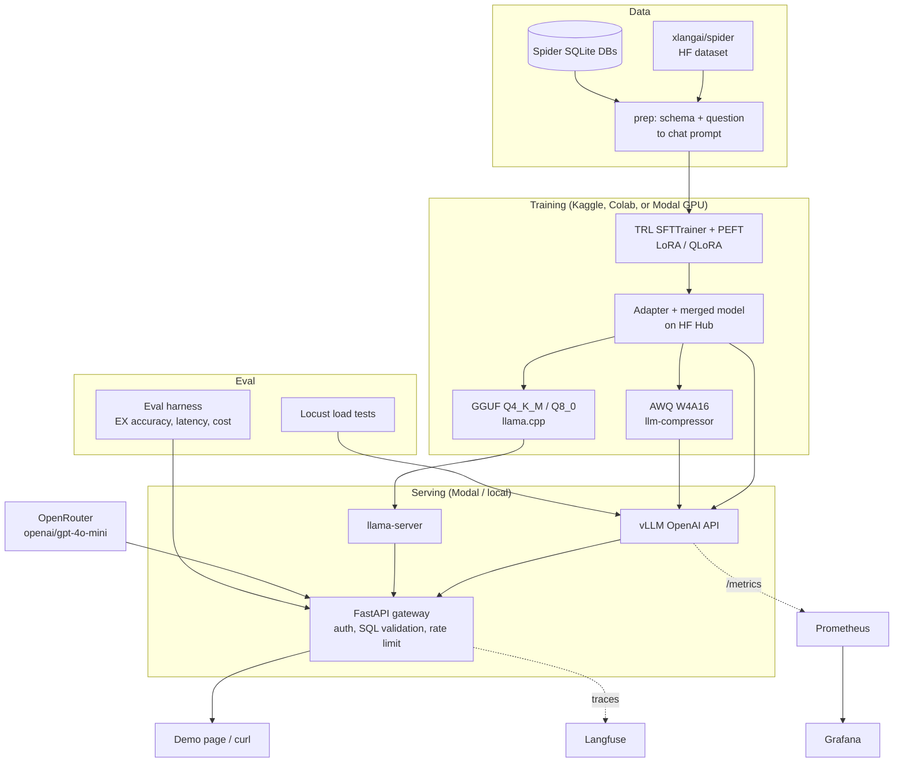

# LocalLLM Ops

**Text-to-SQL evaluation, guarded API access, and a reproducible path to small-model fine-tuning and serving.**


[](LICENSE)

LocalLLM Ops turns an English question and database schema into a SQLite query, validates the query, and optionally executes it read-only. It brings together data preparation, execution-based evaluation, measured API costs, a FastAPI gateway, and training/serving tooling for `Qwen/Qwen2.5-1.5B-Instruct`.

The engineering question is practical: **when does a small, self-hosted SQL model become a useful alternative to a hosted API?** The repository implements the measurement and deployment path; the comparison is not complete yet.

> **In development — not a finished model release.** Hosted GPT baselines are measured and committed. Qwen fine-tuning, quantized-model quality, GPU-serving benchmarks, and production deployment remain pending. There is no permanent public demo or published adapter yet.

[Quick start](#quick-start) · [Results](#results) · [Architecture](#architecture) · [Runbook](RUNBOOK.md) · [Contributing](CONTRIBUTING.md)

## What is implemented

- **Reproducible data preparation:** Spider questions, schema extraction, fixed train/validation/evaluation splits, and official SQLite database download support.
- **SQL execution evaluation:** compare predicted and reference query results, record invalid SQL, and report latency and cost alongside quality.
- **Guarded API gateway:** optional API-key authentication, rate limiting, a single-`SELECT` allow-list, read-only execution, timeouts, and configurable backend fallback.
- **Training workflows:** LoRA/QLoRA configurations, assistant-token-only supervision, Kaggle/Colab notebooks, and Modal entrypoints. GPU runs are not yet measured.
- **Serving and quantization tooling:** vLLM command generation, Modal deployment configuration, AWQ recipes, and llama.cpp GGUF conversion scripts.
- **Observability and checks:** structured logs, optional Langfuse traces, Prometheus/Grafana configuration, Locust scenarios, and regression-test workflows.

## Project status

| Area | Evidence / status |
|---|---|
| CPU checks | 48 tests passed; lint/format checks and both 20-example smoke evaluations passed on 11 Nov 2026 |
| Hosted-model baselines | GPT-4o-mini and GPT-5-mini results committed under [`results/final/`](results/final/) |
| Qwen training | Configurations and notebooks available; adapter training/evaluation pending |
| Quantization and GPU serving | Tooling available; measured quality, memory, throughput, and cold-start results pending |
| Public hosting and walkthrough | Not published; [demo script](docs/demo_script.md) available |

Workflow definitions are included, but **GitHub Actions is currently disabled** for this repository. No green CI status is implied by the checks above.

## Architecture



The diagram includes the intended GPU training and serving paths; it does not represent a currently deployed model service.

Request path: client, FastAPI gateway, backend (`tiny`, `base`, `ft-lora`, `ft-awq`, `ft-gguf`, or `gpt-4o-mini`), SQL allow-list (`sqlglot`), optional read-only SQLite execution. Every call is a structured log, and a Langfuse trace when `LANGFUSE_PUBLIC_KEY` and `LANGFUSE_SECRET_KEY` are set.

## Results

**Dataset convention:** the 1,034 public Spider development examples (Hugging Face's validation split) are called `test` inside this project. These are **not** the official hidden Spider test set. The 7,000 training examples are split into 6,650 training and 350 validation rows.

The block below is generated from [`results/final/`](results/final/) by `make results-table`. Preserve its markers when editing. The two hosted-model rows come from the 10 Nov 2026 run; `pending` means no corresponding measurement is published.

<!-- RESULTS:START -->
### Quality (Spider test split, 1,034 questions)

| Model | Exec. accuracy (EX) | Exact match | Invalid SQL % | Notes |
|---|---|---|---|---|
| Qwen2.5-1.5B base | pending | pending | pending | zero-shot |
| + LoRA | pending | pending | pending |  |
| + QLoRA | pending | pending | pending |  |
| + LoRA, AWQ W4A16 | pending | pending | pending |  |
| + LoRA, GGUF Q4_K_M | pending | pending | pending |  |
| GPT-4o-mini (OpenRouter) | 0.762 | 0.064 | 0.68% | measured 10 Nov 2026, OpenRouter, full test split, n=1034, seed 42, temperature 0, p50/p95 1103/1898 ms |
| GPT-5-mini (OpenRouter) | 0.756 | 0.059 | 0.68% | measured 10 Nov 2026, OpenRouter, full test split, n=1034, seed 42, temperature 0, reasoning minimal, p50/p95 1182/2015 ms |

### Serving

| Variant | Disk | GPU memory | TTFT p50 | TTFT p95 | E2E p50 | E2E p95 | Tokens/s | Cold start |
|---|---|---|---|---|---|---|---|---|
| FP16 | pending | pending | pending | pending | pending | pending | pending | pending |
| AWQ W4A16 | pending | pending | pending | pending | pending | pending | pending | pending |
| GGUF Q8_0 | pending | pending | pending | pending | pending | pending | pending | pending |
| GGUF Q4_K_M | pending | pending | pending | pending | pending | pending | pending | pending |

### Cost

| Item | Value |
|---|---|
| Training GPU-hours | pending |
| Training cost | pending |
| Self-hosted cost per 1k queries | pending |
| GPT-4o-mini cost per 1k queries | $0.059 (measured 10 Nov 2026, OpenRouter usage.cost, total $0.061, n=1034) |
| GPT-5-mini cost per 1k queries | $0.172 (measured 10 Nov 2026, OpenRouter usage.cost, reasoning minimal, total $0.178, n=1034) |
| Break-even requests/s | pending |

Exact match is a whitespace-normalized string comparison, so it stays low when the SQL text differs and the query still returns the same rows. Execution accuracy is the main metric. Qwen, serving, and self-hosted cost stay `pending` until the trained adapter is evaluated. Per-row JSONL files are not committed.
<!-- RESULTS:END -->

Charts (tokens/s vs concurrency, p95 vs concurrency, quantization trade-off) are drawn by `notebooks/analysis.ipynb` after those CSVs exist. None are checked in.

The CPU smoke test is a separate, real run. `make smoke-eval` scores a 20-question fixture with a keyword generator named `tiny-keyword-sql`. That score is not a Qwen result and is not copied into the table above. On the fixture run checked into `results/smoke/`, execution accuracy was 0.55 (11 of 20), exact match was 0.55, and the invalid-SQL rate was 0. Those three numbers are from executing the keyword SQL against the fixture databases, not from a neural model.

### How cost is computed

The cost table uses measured OpenRouter `usage.cost` from the 10 Nov 2026 full test split: $0.059 per 1k queries for GPT-4o-mini ($0.061 total) and $0.172 per 1k for GPT-5-mini with reasoning effort minimal ($0.178 total). Those figures replace the earlier list-price placeholder.

Self-hosted cost is still pending. When a serving run exists it is:

```text
cost_per_1k = gpu_usd_per_hour / requests_per_second / 3600 * 1000
```

If a response has no `usage.cost`, the baseline sums numeric `usage.cost_details` keys that contain `cost`. The token price table is only the fallback after that, and the CSV records `cost_source`:

```text
cost = input_tokens / 1e6 * input_usd_per_million + output_tokens / 1e6 * output_usd_per_million
```

Fallback list prices, checked 10 Nov 2026 for `openai/gpt-4o-mini`: $0.15 / 1M input tokens and $0.60 / 1M output tokens. Override with `OPENROUTER_INPUT_USD_PER_MILLION` and `OPENROUTER_OUTPUT_USD_PER_MILLION` if the price page has moved. The break-even rate is the throughput where self-hosted cost matches the measured OpenRouter cost. Fill it only from a measured requests/s and the GPU price you actually paid. Commands are in `BASELINE_RUN.md`.

## Quick start

Run these commands **inside GitHub Codespaces or another Linux cloud development environment** to avoid installing dependencies or models on your laptop. A local Linux environment is also supported if you choose to use one.

Prerequisites: Python 3.11+, [uv](https://docs.astral.sh/uv/), and GNU Make. No GPU or API key is needed for this CPU-only path. Open a Codespace from **Code → Codespaces → Create codespace on main**, or clone the repository in your cloud workspace:

```bash
git clone https://github.com/saadkhan2003/LocalLLM-Ops.git
cd LocalLLM-Ops
```

```bash
uv sync --extra dev
make ci
uv run uvicorn localllm.gateway.app:app --host 127.0.0.1 --port 8747
```

Open port **8747** from the Codespaces Ports panel, keeping visibility **Private**. On a local environment, visit [http://127.0.0.1:8747](http://127.0.0.1:8747).

From a second terminal in the same environment:

```bash
curl --fail-with-body http://127.0.0.1:8747/healthz
curl --fail-with-body http://127.0.0.1:8747/v1/sql \
  -H 'Content-Type: application/json' \
  -d '{"question":"How many students are there?","db_id":"school","backend":"tiny","execute":true}'
```

`school` is a built-in fixture and `tiny` is a keyword-based test backend, **not a trained LLM**. This verifies the request/validation/execution path without downloading model weights or calling a paid service.

`make serve` is an alternative development entrypoint, but binds to `0.0.0.0`. Authentication is disabled by default; set `GATEWAY_API_KEY` before exposing the process outside a private development environment. The gateway is not a substitute for database isolation or a production security review.

### Development commands

| Command | What it does | Needs |
|---|---|---|
| `make ci` | ruff, pytest, 20-example mock eval, 20-example tiny eval | CPU |
| `make data-small` | stream 200 Spider train rows and 200 validation rows | network |
| `make data` | full splits plus official SQLite (`--download-sqlite --require-sqlite`) | network |
| `make train-dry` | validate the T4 QLoRA config and write a manifest | CPU |
| `make serve` | FastAPI gateway and the demo page | CPU |
| `make loadtest` | short Locust run against the gateway | CPU, server up |
| `make awq-dry` | print the AWQ recipe | CPU |

GPU training, quantization, vLLM, and the paid baseline are in `RUNBOOK.md`. They are not part of `make ci`.

Spider questions come from [`xlangai/spider`](https://huggingface.co/datasets/xlangai/spider); check the dataset card and upstream terms before redistribution. The public validation/development split is evaluation-only in this project and is never used for training. `make data` downloads the official SQLite zip linked by the [Spider project](https://yale-lily.github.io/spider) into `data/spider/database/` and exits if any required `db_id` has no database file. Data and model artifacts stay out of Git. `make data-small` builds prompts only.

### Configuration and secrets

Use [`.env.example`](.env.example) as the variable reference. Prefer repository-selected Codespaces secrets for cloud development; never commit a populated `.env`.

| Integration | Variables | Needed for the CPU quick start? |
|---|---|---|
| Gateway authentication | `GATEWAY_API_KEY` | No, while private; required before broader exposure |
| Hosted baselines / fallback | `OPENROUTER_API_KEY` | No; real calls may be billed |
| Model downloads / publication | `HF_TOKEN`, `HUGGING_FACE_HUB_TOKEN` | No; see notebook instructions |
| Modal | `MODAL_TOKEN_ID`, `MODAL_TOKEN_SECRET` | No; deployment can incur GPU charges |
| Langfuse | `LANGFUSE_PUBLIC_KEY`, `LANGFUSE_SECRET_KEY`, `LANGFUSE_HOST` | No |
| Self-hosted inference | `VLLM_BASE_URL`, `LLAMACPP_BASE_URL` | No |

For budget-limited paid baselines, use the explicit commands in [BASELINE_RUN.md](BASELINE_RUN.md). Training, quantization, and real serving are documented in [RUNBOOK.md](RUNBOOK.md). Free GPU quotas and provider prices can change; deployment files do not imply a funded or running service.

## Design decisions

- **A small instruct model first.** Qwen2.5-1.5B-Instruct is the target for the T4 QLoRA workflow. Fit, runtime, and quality still need to be measured on the selected hardware. Pretraining overlap with Spider cannot be ruled out; compare base and fine-tuned scores under the same protocol and check model licenses before redistribution.
- **LoRA r=16, alpha=32, lr 2e-4.** A common starting point on the attention and MLP projections. The T4 config uses NF4 QLoRA, batch 1, gradient accumulation 16, sequence length 1,024, fp16. Loss is masked to the assistant SQL tokens (`assistant_only_loss`).
- **AWQ via llm-compressor.** AutoAWQ is archived. The recipe is `AWQModifier` plus `QuantizationModifier`, scheme `W4A16_ASYM`, `lm_head` ignored. GGUF Q4_K_M and Q8_0 cover CPU serving through llama.cpp.
- **Modal for serve, free T4 for the first train.** Modal scale-to-zero (`min_containers=0`, 120 second idle window, max 1 container) is the demo path. Kaggle or Colab is the $0 training path. Check the provider price page before a Modal run. On 10 Nov 2026, Modal listed T4 around $0.59/h and L4 around $0.80/h, plus CPU and memory, with a starter credit. Those numbers are a budget hint, not a result.
- **Execution accuracy, not a vibe check.** The harness runs the predicted SQL and the gold SQL on every `.sqlite` file in the database directory and compares result multisets. Column order may differ. Row order matters when the gold query contains `ORDER BY`. `DISTINCT` is removed by default, matching the official `test-suite-sql-eval` CLI. String exact match here is whitespace-normalized equality. The official clause-level exact match needs Spider's SQL parser, so the README column is that normalized match until you wire the official scorer.
- **One prompt everywhere.** System text is `You write SQLite SQL. Return only SQL.` The user message is the schema and the question. The assistant message is the SQL.

## Limitations

- SQLite only. The gateway rejects anything that is not a single `SELECT` (including `WITH` / `UNION`).
- Spider is an academic cross-domain set, not your warehouse.
- No multi-turn dialogue.
- The base model may still have seen similar SQL. Report the base score next to the fine-tune.
- The keyword backend (`tiny`) is a CPU stand-in for tests and the demo page. It is not a language model.
- Difficulty labels on the 20-question fixture were assigned for that fixture. Official Spider hardness is not computed in the smoke test.

## Roadmap

- [x] Implement data preparation, execution scoring, gateway safeguards, and CPU regression tests.
- [x] Record hosted-model baseline quality and actual API costs.
- [ ] Complete the Kaggle QLoRA run and publish adapter evaluation against the base model.
- [ ] Measure AWQ/GGUF quality changes, artifact sizes, and GPU/CPU serving behavior.
- [ ] Run controlled concurrency tests and calculate self-hosted cost from observed throughput.
- [ ] Verify live observability, publish a model card, and record a walkthrough.

These are completion milestones, not claims that a production model or hosted service is already available.

## Repository map

```text
configs/                 LoRA, QLoRA, T4 smoke, eval
src/localllm/data/       Spider prep, schema text, prompt
src/localllm/train/      SFT entrypoint (dry-run without torch)
src/localllm/eval/       harness, execution match, cost, regression
src/localllm/quant/      llm-compressor AWQ, llama.cpp GGUF
src/localllm/gateway/    FastAPI gateway and demo page
src/localllm/serve/      vLLM command builder
deploy/modal_*.py        Modal train and vLLM (you deploy these)
deploy/monitoring/       Prometheus, alert rules, Grafana dashboard
loadtest/locustfile.py   streaming load test
notebooks/               Kaggle, Colab, analysis
.github/workflows/       lint, tests, smoke eval, image, nightly, Modal tag
```

## Contributing and security

See [CONTRIBUTING.md](CONTRIBUTING.md) for development checks and evidence requirements. Report security concerns using [SECURITY.md](SECURITY.md); do not publish credentials, private database contents, or sensitive query logs in issues.

## License

Source code is distributed under the [MIT License](LICENSE). Dataset, model, and third-party dependency licenses apply separately. No trained adapter or merged-model release is currently included.

## Author

Built by **[Muhammad Saad Khan](https://saad-khan.xyz)**, Applied AI Engineer and founder of **[Stack & Scale](https://stackandscale.org)**, a software house building web, mobile, desktop, AI-agent, and automation solutions.

[GitHub](https://github.com/saadkhan2003) · [LinkedIn](https://www.linkedin.com/in/saadkhan2003/) · [Engineering notes](NOTES.md)
