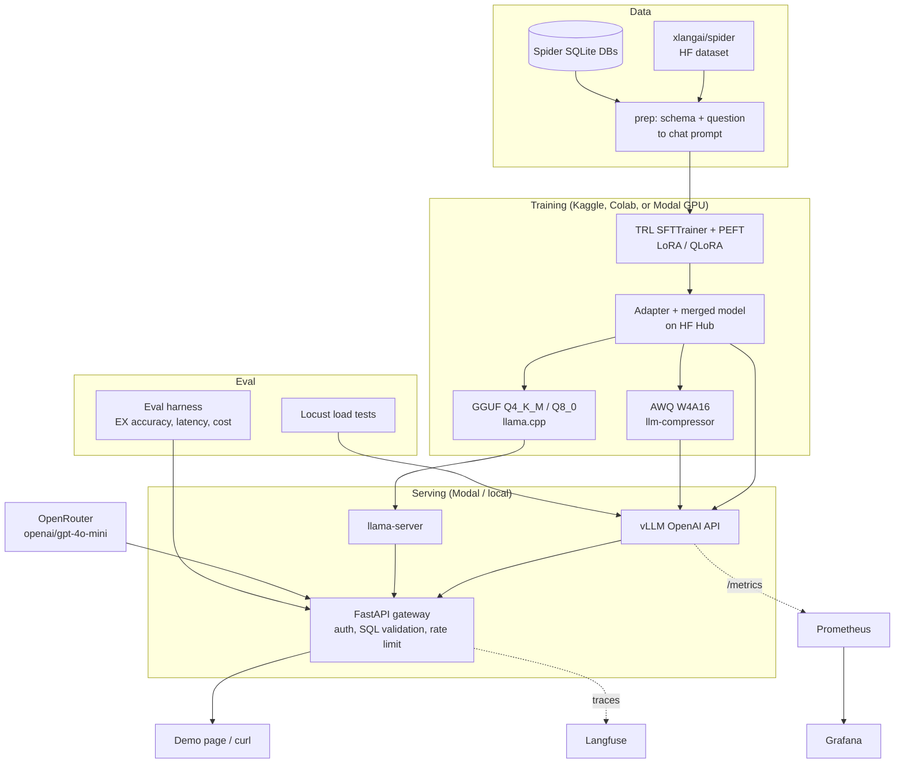

# LocalLLM Ops

Fine-tune a small Qwen model for text-to-SQL, then measure it, quantize it, and serve it.

Live demo: not deployed yet. The local gateway is `make serve` (port 8747).
Two-minute video: not recorded yet. The shot list is `docs/demo_script.md`.

Muhammad Saad Khan · applied AI / ML engineer portfolio project.

A user sends an English question and a database schema. The service returns one SQLite query, checks that it is a single `SELECT`, and can run it read-only. The model path is `Qwen/Qwen2.5-1.5B-Instruct`, fine-tuned with LoRA and QLoRA on [Spider](https://yale-lily.github.io/spider), served with vLLM, compared with GPT-4o-mini on OpenRouter. This repository contains the code, tests, and deployment entrypoints. It does not contain measured model scores. Those cells stay `pending` until the GPU and API runs in `RUNBOOK.md` are done.

## Architecture



Request path: client, FastAPI gateway, backend (`tiny`, `base`, `ft-lora`, `ft-awq`, `ft-gguf`, or `gpt-4o-mini`), SQL allow-list (`sqlglot`), optional read-only SQLite execution. Every call is a structured log, and a Langfuse trace when `LANGFUSE_PUBLIC_KEY` and `LANGFUSE_SECRET_KEY` are set.

## Results

<!-- RESULTS:START -->
### Quality (Spider test split, 1,034 questions)

| Model | Exec. accuracy (EX) | Exact match | Invalid SQL % | Notes |
|---|---|---|---|---|
| Qwen2.5-1.5B base | pending | pending | pending | zero-shot |
| + LoRA | pending | pending | pending |  |
| + QLoRA | pending | pending | pending |  |
| + LoRA, AWQ W4A16 | pending | pending | pending |  |
| + LoRA, GGUF Q4_K_M | pending | pending | pending |  |
| GPT-4o-mini (OpenRouter) | pending | pending | pending | OpenRouter list price, not a measured score |

### Serving

| Variant | Disk | GPU memory | TTFT p50 | TTFT p95 | E2E p50 | E2E p95 | Tokens/s | Cold start |
|---|---|---|---|---|---|---|---|---|
| FP16 | pending | pending | pending | pending | pending | pending | pending | pending |
| AWQ W4A16 | pending | pending | pending | pending | pending | pending | pending | pending |
| GGUF Q8_0 | pending | pending | pending | pending | pending | pending | pending | pending |
| GGUF Q4_K_M | pending | pending | pending | pending | pending | pending | pending | pending |

### Cost

| Item | Value |
|---|---|
| Training GPU-hours | pending |
| Training cost | pending |
| Self-hosted cost per 1k queries | pending |
| GPT-4o-mini cost per 1k queries | pending |
| Break-even requests/s | pending |

Numbers stay `pending` until `results/final/*.csv` exists. Do not type measured scores by hand. Run `make results-table` after a real eval.
<!-- RESULTS:END -->

Charts (tokens/s vs concurrency, p95 vs concurrency, quantization trade-off) are drawn by `notebooks/analysis.ipynb` after those CSVs exist. None are checked in.

The CPU smoke test is a separate, real run. `make smoke-eval` scores a 20-question fixture with a keyword generator named `tiny-keyword-sql`. That score is not a Qwen result and is not copied into the table above. On the fixture run checked into `results/smoke/`, execution accuracy was 0.55 (11 of 20), exact match was 0.55, and the invalid-SQL rate was 0. Those three numbers are from executing the keyword SQL against the fixture databases, not from a neural model.

### How cost will be computed

Self-hosted, at a measured throughput:

```text
cost_per_1k = gpu_usd_per_hour / requests_per_second / 3600 * 1000
```

OpenRouter, from token counts on the response:

```text
cost = input_tokens / 1e6 * input_usd_per_million + output_tokens / 1e6 * output_usd_per_million
```

Default list prices, checked 10 Nov 2026 for `openai/gpt-4o-mini`: $0.15 / 1M input tokens and $0.60 / 1M output tokens. Override with `OPENROUTER_INPUT_USD_PER_MILLION` and `OPENROUTER_OUTPUT_USD_PER_MILLION` if the price page has moved. The break-even rate is the throughput where the two formulas match. Fill it only from a measured requests/s and the GPU price you actually paid.

## How to run locally

Python 3.11+ and [uv](https://docs.astral.sh/uv/).

```bash
cp .env.example .env
uv sync --extra dev
make ci
make serve
```

Gateway: [http://127.0.0.1:8747](http://127.0.0.1:8747). Auth is off until `GATEWAY_API_KEY` is set. Set it before the process is reachable beyond your machine.

| Command | What it does | Needs |
|---|---|---|
| `make ci` | ruff, pytest, 20-example mock eval, 20-example tiny eval | CPU |
| `make data-small` | stream 200 Spider train rows and 200 validation rows | network |
| `make data` | stream the full 7,000 / 1,034 splits | network |
| `make train-dry` | validate the T4 QLoRA config and write a manifest | CPU |
| `make serve` | FastAPI gateway and the demo page | CPU |
| `make loadtest` | short Locust run against the gateway | CPU, server up |
| `make awq-dry` | print the AWQ recipe | CPU |

GPU training, quantization, vLLM, and the paid baseline are in `RUNBOOK.md`. They are not part of `make ci`.

Spider questions come from `xlangai/spider` (CC BY-SA 4.0): 7,000 train and 1,034 validation. The validation split is the test set and is never trained on. Five percent of train is held out as `val` (6,650 / 350 when the train split is 7,000). The SQLite files are not in the Hugging Face dataset. Download them from the official [Spider page](https://yale-lily.github.io/spider) before you report execution accuracy. Prep can still build prompts from a public schema mirror; `manifest.json` lists databases that have no `.sqlite` file.

## Design decisions

- **1.5B, not Qwen2.5-Coder.** Qwen2.5-1.5B-Instruct is small enough for a free T4 with QLoRA and for a cheap serve GPU. Qwen2.5-Coder has very likely seen Spider, so a fine-tuning gain would be hard to read. The 1.5B model card lists Apache 2.0. The 3B model uses a different Qwen license; confirm both on the model cards before you train the stretch model.
- **LoRA r=16, alpha=32, lr 2e-4.** A common starting point on the attention and MLP projections. The T4 config uses NF4 QLoRA, batch 1, gradient accumulation 16, sequence length 1,024, fp16. Loss is masked to the assistant SQL tokens (`assistant_only_loss`).
- **AWQ via llm-compressor.** AutoAWQ is archived. The recipe is `AWQModifier` plus `QuantizationModifier`, scheme `W4A16_ASYM`, `lm_head` ignored. GGUF Q4_K_M and Q8_0 cover CPU serving through llama.cpp.
- **Modal for serve, free T4 for the first train.** Modal scale-to-zero (`min_containers=0`, 120 second idle window, max 1 container) is the demo path. Kaggle or Colab is the $0 training path. Check the provider price page before a Modal run. On 10 Nov 2026, Modal listed T4 around $0.59/h and L4 around $0.80/h, plus CPU and memory, with a starter credit. Those numbers are a budget hint, not a result.
- **Execution accuracy, not a vibe check.** The harness runs the predicted SQL and the gold SQL on every `.sqlite` file in the database directory and compares result multisets. Column order may differ. Row order matters when the gold query contains `ORDER BY`. `DISTINCT` is removed by default, matching the official `test-suite-sql-eval` CLI. String exact match here is whitespace-normalized equality. The official clause-level exact match needs Spider's SQL parser, so the README column is that normalized match until you wire the official scorer.
- **One prompt everywhere.** System text is `You write SQLite SQL. Return only SQL.` The user message is the schema and the question. The assistant message is the SQL.

## Limitations

- SQLite only. The gateway rejects anything that is not a single `SELECT` (including `WITH` / `UNION`).
- Spider is an academic cross-domain set, not your warehouse.
- No multi-turn dialogue.
- The base model may still have seen similar SQL. Report the base score next to the fine-tune.
- The keyword backend (`tiny`) is a CPU stand-in for tests and the demo page. It is not a language model.
- Difficulty labels on the 20-question fixture were assigned for that fixture. Official Spider hardness is not computed in the smoke test.

## What I'd do next

Preference optimization on the harness failures, the BIRD dataset, speculative decoding, and more than one LoRA on the same vLLM process.

## Repository map

```text
configs/                 LoRA, QLoRA, T4 smoke, eval
src/localllm/data/       Spider prep, schema text, prompt
src/localllm/train/      SFT entrypoint (dry-run without torch)
src/localllm/eval/       harness, execution match, cost, regression
src/localllm/quant/      llm-compressor AWQ, llama.cpp GGUF
src/localllm/gateway/    FastAPI gateway and demo page
src/localllm/serve/      vLLM command builder
deploy/modal_*.py        Modal train and vLLM (you deploy these)
deploy/monitoring/       Prometheus, alert rules, Grafana dashboard
loadtest/locustfile.py   streaming load test
notebooks/               Kaggle, Colab, analysis
.github/workflows/       lint, tests, smoke eval, image, nightly, Modal tag
```

## CV line

Fill the brackets from `results/final/` only.

**LocalLLM Ops — Fine-tuned and self-hosted text-to-SQL LLM** | Python, PyTorch, TRL/PEFT, vLLM, llm-compressor, llama.cpp, FastAPI, Modal, Locust, Langfuse, Prometheus, Grafana, GitHub Actions

- Fine-tuned Qwen2.5-1.5B with LoRA/QLoRA on Spider text-to-SQL, raising execution accuracy from [X]% to [Y]% on the 1,034-question test set ([Z] points vs GPT-4o-mini).
- Quantized the model to 4-bit AWQ and GGUF, cutting model size by [X]% and GPU memory by [Y]% with a [Z]-point accuracy change.
- Served with vLLM on serverless GPUs; load-tested to [N] concurrent users at [X] tokens/s and p95 latency of [Y] s.
- Built an evaluation harness and a nightly regression check; cost per 1k queries $[X] self-hosted vs $[Y] for GPT-4o-mini.

Hugging Face model card: not published yet. Push the merged weights as `<you>/qwen2.5-1.5b-spider-sql` after the eval, with the license, the data split, the metrics, and the contamination note.

CI is `.github/workflows/ci.yml` (lint, unit tests, 20-example mocked eval, tiny-model smoke) on every push and pull request.
